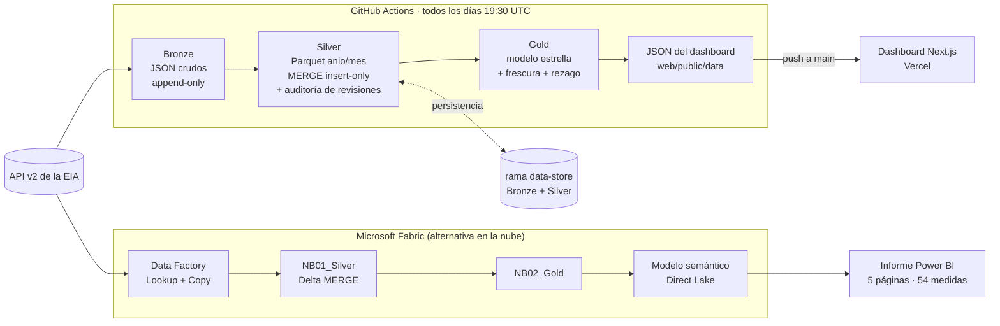

# Pulso Energético de EE. UU. — Petróleo y gas

[](https://github.com/licgermancardenas-crypto/ENERGIA-EEUU/actions/workflows/ci.yml)
[](https://github.com/licgermancardenas-crypto/ENERGIA-EEUU/actions/workflows/actualizacion-diaria.yml)

Pipeline medallón (**Bronze → Silver → Gold**) sobre la API abierta de la **EIA** (U.S. Energy Information Administration), con un dashboard web estático que se actualiza todos los días y la especificación completa de un informe **Power BI** sobre **Microsoft Fabric**.

**Pregunta de negocio:** ¿cómo están hoy el petróleo y el gas natural de EE. UU. (precios, inventarios, producción y consumo) y cuánto tarda la producción de crudo en reaccionar al precio?

Autor: **German Cardenas** · Licencia MIT

---

## Qué hay en el proyecto

| Pieza | Dónde | Qué hace |
|---|---|---|
| Pipeline local | `src/eia_pulso/` | Descarga 10 datasets de la EIA y arma la carga histórica acumulativa (append-only, sin duplicados). Publica un modelo estrella en Parquet y DuckDB. |
| Dashboard web | `web/` | Next.js con export estático, Tailwind y Recharts, en Vercel. Lee JSON generados desde Gold. |
| Fabric | `fabric/` | Notebooks PySpark/Delta (`NB01_Silver`, `NB02_Gold`) con `MERGE` real, y la guía de Lakehouse, pipeline de Data Factory y refresh. |
| Power BI | `powerbi/` | Especificación del informe, 54 medidas DAX, tema visual y valores para validar. |
| Automatización | `.github/workflows/` | Corrida diaria (pipeline → JSON → deploy) y CI de tests y lint. |

### Datasets (solo petróleo y gas natural)

| Dataset | Ruta EIA v2 | Series | Desde |
|---|---|---|---|
| Precios spot diarios | `petroleum/pri/spt` | WTI (Cushing), Brent | 2023 |
| Henry Hub diario | `natural-gas/pri/fut` | RNGWHHD | 2023 |
| Precios spot mensuales | `petroleum/pri/spt` · `natural-gas/pri/fut` | WTI, Brent, Henry Hub | 2010 |
| Precios en surtidor | `petroleum/pri/gnd` | Gasolina regular, media y premium; diésel | 2023 |
| Inventarios semanales | `petroleum/stoc/wstk` | Crudo comercial, SPR, gasolina, destilados | 2023 |
| Producción de crudo | `petroleum/crd/crpdn` | MCRFPUS2 | 2010 |
| Almacenamiento de gas | `natural-gas/stor/wkly` | 5 regiones + Lower 48 | 2023 |
| Consumo de gas | `natural-gas/cons/sum` | 5 sectores + total | 2010 |
| Producción de gas | `natural-gas/prod/sum` | Gas seco y comercializado | 2010 |

Todas las rutas y series se verificaron contra la API real. Ojo con una trampa: Henry Hub está en `natural-gas/pri/fut`, no en `pri/sum`.

---

## Arquitectura



**Reglas del pipeline**

- **Bronze**
  - Cada corrida escribe archivos nuevos; nunca se pisa uno existente.
  - La carga es incremental: arranca en la fecha máxima de Silver menos una ventana de relectura (30 días para series diarias, 8 semanas para semanales y 6 meses para mensuales), para captar revisiones recientes.
- **Silver**
  - Valida cada fila: sin fecha, sin valor, serie desconocida o valor no positivo.
  - Descarta los últimos 2 días de los datos diarios, porque pueden estar incompletos.
  - Inserta solo claves nuevas `(dataset, serie, periodo)`.
  - Si la EIA revisa un valor ya cargado, **no se pisa**: queda registrado en la auditoría de revisiones.
- **Gold**
  - Se reconstruye entero en memoria y **se valida antes de reemplazar** al anterior: tablas no vacías, claves únicas, integridad referencial y conciliación de conteos con Silver.
  - Si algo falla, el Gold previo queda intacto.
- **Frescura**
  - Se mide el atraso desde el fin del período.
  - Tolerancia: 10 días para series diarias, 14 para semanales y 120 para mensuales.

### Análisis de rezago (precio → producción)

Correlación de Pearson entre la variación % mensual del WTI en *t* y la de la producción de crudo en *t + k*, con *k* = 0 a 12 meses. Se calcula en dos escenarios, porque 2020 domina el resultado:

| Escenario | Rezago con mayor correlación | r | Meses comparados |
|---|---:|---:|---:|
| Historia completa (2010–2026) | 1 mes | 0,36 | 198 |
| Sin 2020–2021 (pandemia) | 7 meses | 0,20 | 160 |

> ⚠️ **Descriptivo, no causal.** Mide cuánto se parecen los movimientos con distintos desfasajes; no prueba que el precio cause la producción. Las correlaciones son débiles a moderadas, y la producción también depende de costos, tecnología, infraestructura y decisiones de las empresas.

---

## Reproducirlo en menos de 30 minutos

**Requisitos:** Python 3.11+, Node.js 22+, Git y una API key gratuita de la EIA.

### 1. Clonar e instalar (≈ 5 min)

```bash
git clone https://github.com/licgermancardenas-crypto/ENERGIA-EEUU.git
cd ENERGIA-EEUU
python -m venv .venv
# Windows: .venv\Scripts\activate   ·   macOS/Linux: source .venv/bin/activate
pip install -e ".[dev]"
```

### 2. API key de la EIA (≈ 2 min)

1. Pedila en <https://www.eia.gov/opendata/register.php>. Llega por mail al instante.
2. Copiá `.env.example` a `.env` y completá `EIA_API_KEY=...`.

El archivo `.env` está en `.gitignore`. El pipeline nunca imprime la key: los logs la enmascaran.

### 3. Correr el pipeline (≈ 3–5 min, la primera vez baja toda la historia)

```bash
python -m eia_pulso run              # Bronze → Silver → Gold
python -m eia_pulso run              # segunda corrida: incremental, inserta 0 filas si no hubo datos nuevos
python -m eia_pulso export-web       # Gold → web/public/data/*.json
```

Al final se imprimen:
- los conteos por capa;
- la frescura de cada fuente;
- los dos escenarios del rezago.

Gold queda en `data/gold/`: Parquet, `pulso.duckdb` y los JSON de frescura y rezago.

### 4. Tests y calidad (≈ 3 min)

```bash
pytest          # pipeline, Fabric (paridad de la lógica), exportador web y medidas DAX
ruff check .
```

### 5. Dashboard web (≈ 5 min)

```bash
cd web
npm install
npm run dev      # http://localhost:3000
npm test         # coherencia de los JSON con Gold y formato es-AR
npm run build    # export estático en web/out/
```

### 6. Automatización diaria (≈ 5 min, opcional)

1. Hacé un fork del repo.
2. Cargá el secreto en **Settings → Secrets and variables → Actions → New repository secret**:
   - `EIA_API_KEY`: tu key (obligatorio).
   - `VERCEL_DEPLOY_HOOK_URL`: opcional, solo si no usás la integración Git de Vercel.
3. En **Actions**, habilitá los workflows y corré **Actualización diaria** con *Run workflow*.
   - La primera vez crea la rama `data-store` con la historia completa.
   - Después corre sola todos los días a las 19:30 UTC.
4. **Vercel:**
   - *Add New → Project*, importá el repo con **Root Directory = `web`**. El resto lo toma de `web/vercel.json`.
   - Cada push de la Action a `main` dispara un deploy.
   - Para que no intente desplegar la rama de datos, en *Settings → Git → Ignored Build Step* poné:

     ```bash
     if [ "$VERCEL_GIT_COMMIT_REF" = "data-store" ]; then exit 0; else exit 1; fi
     ```

### 7. Fabric y Power BI (opcional, fuera de los 30 minutos)

- **Fabric:** `fabric/GUIA_FABRIC.md`. Lakehouse, conexión REST anónima, pipeline de Data Factory con alertas, notebooks y programación. Lleva 45–60 min.
- **Power BI:** `powerbi/ESPECIFICACION_POWERBI.md`. Modelo estrella, medidas, páginas y validación. Las medidas se aplican pegando `powerbi/medidas.dax` en la vista de consultas DAX.

---

## Estructura

```
config/pipeline.yaml        datasets, series, ventanas, umbrales y escenarios del rezago
src/eia_pulso/              cliente API, bronze/, silver/, gold/, web/ (exportador) y CLI
tests/                      pytest (cliente, Bronze/Silver, Gold, Fabric, web, Power BI)
fabric/                     notebooks (.py fuente → .ipynb generados), config y guía
powerbi/                    especificación, medidas.dax (generado) y tema
web/                        dashboard Next.js (src/) y datos publicados (public/data)
scripts/                    generadores de artefactos de Fabric y Power BI
.github/workflows/          actualización diaria y CI
docs/                       borrador del post de LinkedIn
```

Los archivos de `fabric/notebooks/*.ipynb`, `fabric/config/*.json` y `powerbi/medidas.dax` se **generan**. No se editan a mano: hay que cambiar la fuente y volver a correr `scripts/generar_*.py`. Los tests fallan si quedaron desactualizados.

---

## Limitaciones

- **Revisiones de la EIA:** Silver es insert-only, así que los valores revisados se **auditan pero no se aplican**. Es una decisión a favor de la trazabilidad. Si se quisiera el último valor publicado, haría falta un MERGE con actualización.
- **Profundidad histórica:** las series diarias y semanales arrancan en 2023 y las mensuales en 2010. El rezago usa solo datos mensuales.
- **Rezago:**
  - Es una correlación, no un modelo causal.
  - No controla otras variables: costos, cantidad de equipos de perforación, demanda.
  - Su resultado cambia mucho según se incluya o no la pandemia.
- **Fabric y Power BI no se ejecutaron en el entorno de desarrollo** (no hay Spark, Fabric ni Power BI).
  - La lógica pura de los notebooks se testea localmente, por paridad con el pipeline.
  - Las medidas DAX se validan estructuralmente contra el esquema Gold.
  - Quedan sin verificar el `MERGE` en Delta, la paginación de la actividad Copy y el cálculo de las medidas dentro de Power BI. La guía y la especificación traen checklists y valores esperados para validarlo.
- **Dashboard estático:** muestra la foto del último build. Si la EIA no publica, los datos quedan quietos, y el panel de frescura lo hace visible.
- **GitHub Actions:**
  - El cron puede demorarse en horas pico.
  - En repos públicos sin actividad durante 60 días, GitHub desactiva los workflows programados. Los commits diarios del bot cuentan como actividad.
- **Crecimiento de `data-store`:** Silver suma archivos Parquet pequeños por corrida. Para años de historia convendría compactar las particiones.

---

## Créditos

- **Datos:** [U.S. Energy Information Administration (EIA), API v2](https://www.eia.gov/opendata/). Datos públicos del Gobierno de EE. UU.
- **Inspiración:** el proyecto [02_EIA de Data-Days-Projects](https://github.com/Edgar-sz/Data-Days-Projects/tree/main/02_EIA) de **Edgar Saico Zea** y **Vicente Antonio Juan Magallanes**. Lo usé como referencia de arquitectura y de contenido del dashboard. El código, los notebooks, las medidas DAX, el diseño visual y los textos de este repositorio son propios.
- **Herramientas:** pandas, DuckDB, PyArrow, pytest, Ruff, Next.js, Tailwind CSS, Recharts, Microsoft Fabric y Power BI.

Hecho por **German Cardenas**.
